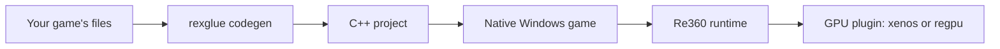

# Re360

Re360 turns Xbox 360 games into native Windows programs. It translates a
game's PowerPC code into C++ ahead of time, then supplies the parts of the
console the game expects: kernel, memory, graphics, audio, input, saves and
the Xbox 360 Guide.

It is one repository for what used to be three:

- **ReCPU** (formerly the ReXGlue SDK): the recompiler and the console runtime.
- **ReGPU**: a lean Xenos renderer that draws into real host textures and
  translates shaders to readable HLSL.
- **Xbox**: the Xbox 360 Guide, played from the console's own scenes.

> Status: alpha. Expect breaking changes. Three games (the Xbox 360 James Bond
> titles) are tested with the default renderer; ReGPU builds and passes its
> plugin test here but has not been run on a game in this repository yet. See
> [what is tested](docs/release-evidence.md).

## How it works



1. `rexglue init` creates a project for a game.
2. `rexglue codegen` translates the game's code to C++. There is no JIT.
3. CMake builds it against the Re360 runtime into a Windows executable.
4. The player points it at their own copy of the game the first time it runs.

No game files are included in this repository or in anything built from it.

## Build Re360

You need Windows 11 x64, Visual Studio 2026 with Clang, CMake, Ninja and the
Microsoft GDK. From a Visual Studio x64 developer prompt:

```powershell
git clone --recurse-submodules https://github.com/furqanagwan/Re360.git
cd Re360
cmake --preset win-amd64-gdk -DREXGLUE_BUILD_TESTS=ON
cmake --build --preset win-amd64-gdk-release
ctest --preset win-amd64-gdk-release --output-on-failure
cmake --install out/build/win-amd64-gdk --config Release
```

Exact tool versions are in [GDK toolchain](docs/gdk-toolchain.md).

## Make a game project

```powershell
rexglue init --project-name MyGame --xex-path D:/Games/MyGame/default.xex --game-root D:/Games/MyGame --project-root D:/Projects/MyGame
cd D:/Projects/MyGame
rexglue codegen
cmake --preset win-amd64-release -DCMAKE_PREFIX_PATH=<path to the installed Re360>
cmake --build --preset win-amd64-release
```

A working example is [furqanagwan/007](https://github.com/furqanagwan/007),
which builds the three Xbox 360 James Bond games.

The command-line tool, CMake package and C++ namespace keep their original
names (`rexglue`, `find_package(rexglue)`, `rex::`), so existing game projects
build against Re360 unchanged.

## Two renderers, one switch

A game project stages both GPU plugins next to its executable and picks one
per run:

| `gpu_plugin` | What it is | Use it for |
| --- | --- | --- |
| `xenos` (default) | Xenia-derived Xenos emulation: EDRAM render-target cache, DXBC shaders, optional DXIL | The tested path and the reference image |
| `regpu` | ReGPU: render targets as host textures, shaders as HLSL, FSR and DLSS upscaling | The lean renderer; see [ReGPU](docs/regpu.md) for what it does not do yet |
| `none` | No GPU | Tools and tests |

```powershell
MyGame.exe --gpu_plugin=regpu
```

Where this is going (shaders translated at build time, then per-game native
renderers) is in the [native GPU plan](docs/native-gpu-plan.md).

## Where things are

| Folder | What it holds |
| --- | --- |
| `src/codegen` | PowerPC to C++ translation |
| `src/system`, `src/kernel` | The console's runtime and kernel |
| `src/graphics` | The `xenos` GPU plugin |
| `src/regpu`, `include/regpu` | The `regpu` GPU plugin (ReGPU) |
| `src/audio`, `src/input`, `src/filesystem` | Sound, controllers, files and saves |
| `src/ui` | Window, presenter and overlays |
| `src/xbox` | The Xbox 360 Guide and the XUI scenes it plays |
| `tools/regpu` | ReGPU's live debugger, console (XBDM) comparison tools, shader disassembler |
| `tests` | Unit, instruction and GPU tests |
| `docs`, `research` | Design notes, decisions, test evidence and hardware notes |

## Contributing

Read [AGENTS.md](AGENTS.md) and [CONTRIBUTING.md](CONTRIBUTING.md). Work on a
branch and open a pull request; `main` only changes through reviewed PRs with
a passing build.

## License and credits

Re360 is under the BSD 3-Clause license in [LICENSE](LICENSE), except ReGPU
(`src/regpu`, `include/regpu`, `tools/regpu`), which is under the MIT license
in [src/regpu/LICENSE](src/regpu/LICENSE). Not affiliated with or endorsed by
Microsoft or Xbox.

Re360 builds on:

- [ReXGlue](https://github.com/rexglue/rexglue-sdk), founded by
  [Tom](https://github.com/tomcl7), with [Loreaxe](https://github.com/Loreaxe),
  [mystixor](https://github.com/Mystixor), [Graine25](https://github.com/Graine25),
  [mrcmunir](https://github.com/mrcmunir), [sanjay900](https://github.com/sanjay900),
  [Toby](https://github.com/TbyDtch), [Roxxsen](https://github.com/Roxxsen) and
  the wider community. The recompiler and runtime come from it.
- [ReGPU](https://github.com/zer0ducksgiven/ReGPU) by Scott. The `regpu`
  renderer comes from it; its credits and the Xenia notice for the routines
  that follow Xenia's are in [ReGPU](docs/regpu.md#credits-and-licences).
- [Xenia](https://github.com/xenia-project/xenia),
  [Xenia Canary](https://github.com/xenia-canary/xenia-canary),
  [Xenia Edge](https://github.com/has207/xenia-edge),
  [XenonRecomp](https://github.com/hedge-dev/XenonRecomp) and
  [rexdex's recompiler](https://github.com/rexdex/recompiler).
- AMD FidelityFX Super Resolution 1 (MIT), compiled into
  `src/regpu/gpu/bytecode/fsr1_cs.h`.

The histories of all three source repositories are in this one: `git log`
shows ReXGlue's, ReGPU's and the Guide's commits.
